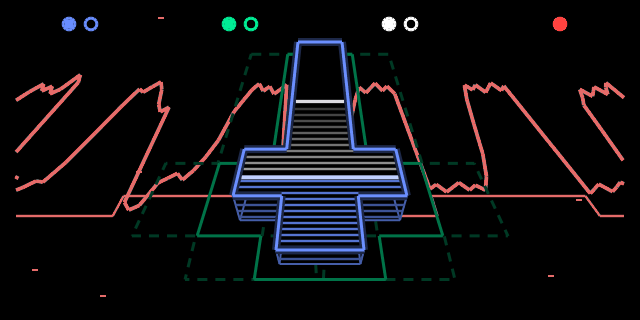

# CROSS

A monophonic French-touch bass engine for the original OP-1, built for Hundekraft.

> **A word first.** CROSS is vibe-coded: it was written with an AI coding assistant. I'm a beginner in sound synthesis, so ideas for new features and improvements are very welcome, whether about the sound, the knobs or the screen. [Open an issue](../../issues) and tell me.

## Overview

CROSS is a bass voice in the spirit of a classic three-oscillator ladder synth. Two oscillators and a sub run into a four-pole ladder filter with its own envelope, then into a level-compensated drive. The oscillators run free and drift very slightly, like analogue ones. Velocity sets both the level and how far the filter opens, so soft notes are darker.

It is strictly monophonic in every OP-1 play mode, with last-note priority. Letting go of a key hands the voice back to the newest key still held, legato, without restarting the filter envelope. The OP-1 supplies the T2 envelope, glide and T3 effect.

## Manual

**Load:** press synth, then Shift + T1, and choose **cross**.

| Encoder | Turn | Push, then turn |
|---|---|---|
| Blue | **Cutoff**: ladder filter, 20 Hz to about 14 kHz, following the keyboard by two thirds. | **Wave**: saw → saw + sub → square + sub → narrow pulse. |
| Green | **Resonance**: the low end stays full as it rises. | **Detune**: second oscillator, 0 to 25 cents, then a fifth, then an octave. |
| White | **Env**: how far the filter envelope opens the cutoff, up to 6 octaves. | **Decay**: filter envelope decay, 5 ms to 2 s. |
| Orange | **Drive**: overloads the mixer up to the middle, then adds drive after the filter. | — |

Push blue, green or white again to return to its main control.
## Download and install

**[cross.knl](download/cross.knl)**, version 0.3.6

Requires the original OP-1 with Hundekraft 3.1 or newer. Tested on a real OP-1 under Hundekraft 3.1.2.

Back up your OP-1 first. Open the [Hundekraft OP-1 Workshop](https://hundekraft.github.io/op1-workshop/), add `cross.knl` under **Your plugins**, press **Review changes**, then **Send to OP-1**, and follow the Workshop's restart instructions.

| Platform | Status |
|---|---|
| Hundekraft 3.1+ | Released, plays well on a real OP-1 |
| Opus 2 | In progress |
| op1r plugin loader | In progress |

## Feedback and ideas

[Open an issue](../../issues) for a bug (with your Hundekraft version and what you heard or saw), or for an idea: a sound you'd like CROSS to make, a knob that should do something else, a better way to do the DSP.

## Credits and license

By Bomb-X, vibe-coded with an AI coding assistant. Built with Hundekraft's Kennel SDK, derived from the op1r plugin SDK by pcppcp and contributors. The plugin source is in `cross/`, the computer-side tools that generate its tables in `tools/`.

GPL-3.0-or-later with the additional OP-1 firmware combination permission: see [LICENSE](LICENSE) and [NOTICE](NOTICE). No Teenage Engineering firmware is included.

Independent project; not affiliated with Teenage Engineering.
